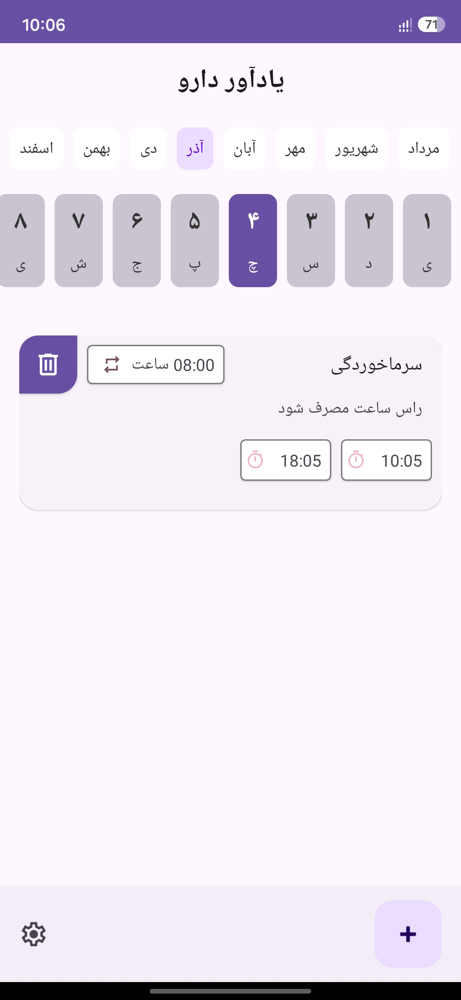
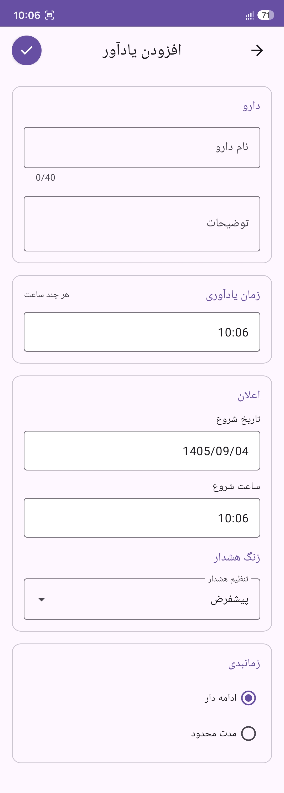
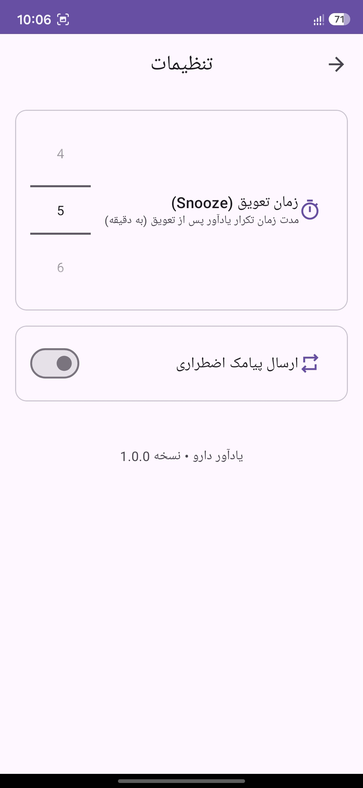

# 💊 اپلیکیشن یادآور دارو (Pill Reminder App)

برنامه اندرویدی **یادآور دارو** یک اپلیکیشن کاربردی و استاندارد برای مدیریت و یادآوری دقیق زمان مصرف داروها است. این پروژه با زبان **Java** و معماری مدرن **MVVM** توسعه یافته و از پایگاه داده محلی **Room** استفاده می‌کند.

---

## 📱 امکانات و ویژگی‌ها
- **مدیریت یادآورها:** ثبت، ویرایش و حذف یادآورهای دارویی با جزئیات کامل.
- **زمان‌بندی پیشرفته:** انتخاب روزهای هفته، ماه‌ها، ساعت شروع و بازه‌های تکرار مصرف دارو.
- **سیستم آلارم و نوتیفیکیشن هوشمند:** پخش صدای هشدار (Alarm)، نمایش نوتیفیکیشن ماندگار (Foreground Service) با دکمه‌های تعاملی **«انجام شد»** و **«تعویق (Snooze)»**.
- **ارسال پیامک اضطراری (پشتیبان):** قابلیت ارسال خودکار پیامک به شماره‌های اضطراری در زمان مصرف دارو.
- **رابط کاربری مدرن (Material 3):** طراحی شده با اصول متریال ۳، کارت‌های زیبا و پشتیبانی کامل از حالت راست‌چین (RTL).

---

## 🖼️ تصاویر محیط برنامه

  
  
  

---

## 🛠️ تکنولوژی‌ها و معماری
- **زبان:** Java
- **معماری:** MVVM (Model - View - ViewModel)
- **پایگاه داده:** Room Database + TypeConverters
- **مدیریت زمان‌بندی:** AlarmManager & BroadcastReceiver
- **مدیریت سرویس‌ها:** Foreground Service + MediaPlayer
- **رابط کاربری:** Material 3 Components, ViewBinding, ConstraintLayout

---

## ⚡ بهینه‌سازی‌ها و پایداری (Optimizations & Robustness)
- **سازگاری کامل با نسخه‌های جدید اندروید:** پشتیبانی از Foreground Service Type برای اندروید ۱۴ و بالاتر.
- **مدیریت هوشمند آلارم‌های دقیق:** پیاده‌سازی امن `AlarmManager` با بررسی مجوزهای سیستمی جهت پایداری بالا.
- **مدیریت چرخه عمر و همگام‌سازی:** به‌کارگیری اصولی `LiveData` و `Repository` برای واکنش‌گرا بودن دیتابیس و رابط کاربری.

---

## 🚀 نحوه نصب و اجرا
1. پروژه را در محیط **Android Studio** (نسخه Iguana به بالا) کلون یا باز کنید.
2. منتظر بمانید تا فایل‌های Gradle سینک شوند.
3. پروژه را روی شبیه‌ساز یا دستگاه واقعی با اندروید ۸ به بالا اجرا کنید.
